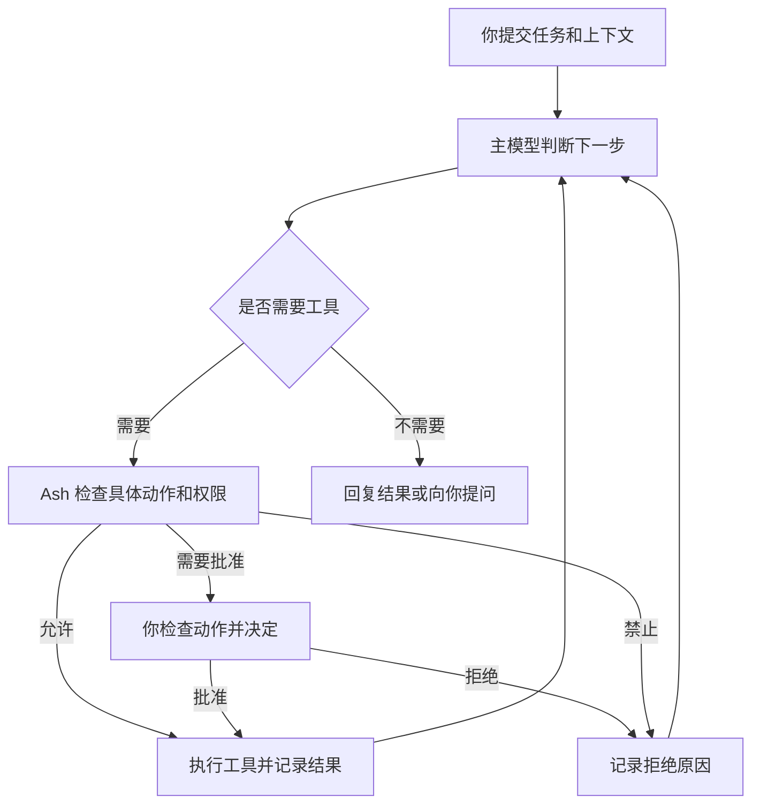

# Agent 概览

Ash Agent 根据你的要求读取代码、调用工具、修改文件并验证结果。你可以查看工具活动、补充要求，并在需要批准时决定是否执行。本页帮助你提交清楚的任务，并判断结果是否满足要求。

## 开始一项任务

1. 打开要处理的项目，确认当前会话对应的目录。
2. 在聊天输入区选择主模型；使用 Ash Code 时，先输入 `/model` 选择模型。
3. 添加关键文件、错误输出或截图，并写明目标、范围和验收条件。
4. 发送后查看工具活动；需要批准或回答时，在对应面板中处理。
5. 完成后核对改动和验证结果，再决定继续当前会话还是新建会话。

模型列表为空或调用提示身份验证失败时，先检查[模型配置](/docs/configure/models.md)。模型出现在列表中，不代表账号凭据、额度或远端服务一定可用。

## 写清楚任务

任务说明包含三部分：

* **结果**：最终需要得到什么。
* **范围**：处理哪些文件、功能或产品。
* **验收**：运行哪些测试，或满足什么可观察行为。

```prompt
修复设置页保存后状态不刷新的问题，只改设置模块。复现问题后再修改，运行相关的浏览器测试，并说明验证结果。
```

如果暂时只想讨论方案，也要直接说明：

```prompt
先分析保存流程中状态不同步的原因，比较两个修复方案和各自风险。等我选定方案后再修改代码。
```

## Agent 如何完成任务

主模型决定下一步需要什么信息或操作；Ash 根据具体动作检查权限，执行工具并把结果交回模型。



读取文件、运行测试和修改外部系统都可以出现在这个过程中，但适用的权限不同。具体规则见[权限与批准](/docs/configure/permissions.md)。

## 提供有效上下文

### 在工作台添加上下文

选择输入区的 **Add context（添加上下文）**，搜索文件，或选择对应来源：

| 你要提供的内容 | 操作与范围 |
| --- | --- |
| 工作区文件或目录 | 搜索文件，或进入 **Files & Folders**。目录附件提供目录路径和文件列表，不会把目录中每个文件的全文都附上 |
| 尚未保存的编辑 | 选择 **Open editors**，或添加对应工作区文件；会读取可用的未保存文本 |
| 错误与复现证据 | 选择 **Terminal** 附上选中文本或最近输出；选择 **Search Results** 附上已有搜索结果 |
| 图片或本地文本文件 | 选择 **Attach files**。支持非空 UTF-8 文本以及 PNG、JPEG、GIF、WebP 图片；图片需要主模型支持 |
| 其他工作的背景 | 在可用来源中选择会话、GitHub Issue、Pull Request 或其他上下文来源 |

按 `Enter` 添加所选项；按 `Ctrl+Enter`（macOS 为 `Command+Enter`）添加后继续选择。发送前检查输入框上方的附件，删除无关内容。发送失败时，附件仍保留在草稿中。

文件、目录、终端、搜索结果和会话附件保存的是选择时取得的内容。如果源内容已经变化，移除后重新添加，或让 Agent 重新读取。选择目录或粘贴文件路径，也不等于相关文件全文已进入上下文。

### 在 Ash Code 提供背景

在提示语中写明文件路径和复现步骤；`@` 可查找文件或 Plugin 提供的候选，选择后作为文字引用提交。用 `$name` 选择 Skill；完整说明按需加载。不要把文件引用当作已经读取全文的证据。

已连接的 MCP 服务器提供工具，其全部数据不会自动加入每条消息。长对话可能使用压缩摘要；需要精确核对代码或日志时，要求 Agent 重新读取相关内容。

## 选择主模型和顾问

主模型负责推进任务。工作台在聊天输入区选择主模型；选择用于该聊天后续提交的新一轮，不会更换正在运行的任务所用模型。切换模型后，可选择该模型支持的推理强度。

Ash Code 使用 `/model`，选择会写入当前连接的默认模型配置。它和工作台聊天内的模型选择作用范围不同；已有任务继续使用开始时确定的模型。详细配置与作用范围见[模型配置](/docs/configure/models.md)。

需要第二意见时，先配置顾问模型。主模型可以在任务中咨询顾问；当前轮结束后，也可以使用 `/advisor <问题>` 手动咨询。顾问只阅读提供的上下文并给出建议，没有自己的工具。手动咨询后等待你的下一步要求，完整用法见 [Advisor 顾问](/docs/agents/advisor.md)。

## 调整方向和检查结果

任务进行中可以补充要求。工作台在模式不变且未选择新 Skill 时，发送消息会补充当前可接收输入的任务；切换模式或选择 Skill 会把消息排队为新一轮。Ash Code 运行中按 `Enter` 排队，按 `Ctrl+Enter` 单次补充当前任务。补充输入不能改换当前任务的模型、模式或工具选择；完整条件、停止与重试步骤见[会话与任务](/docs/agents/sessions.md)。

收到完成回复后，检查：

* 改动是否覆盖了原来的问题。
* 测试是否实际运行并完成。
* 报告的结果是否有工具输出支持。
* 是否还有未完成事项或需要你决定的步骤。

## 下一步

* [检查工具活动与执行结果](/docs/reference/tools.md)
* [用 Skills 复用工作方法](/docs/customize/skills.md)
* [连接 MCP 外部工具](/docs/customize/mcp-servers.md)
