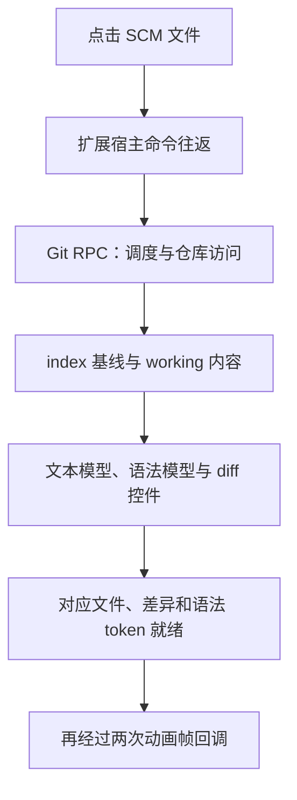

# 一次 diff 点击的长尾：Ash 的 Git 性能复盘

在源代码管理的更改列表中点开一个普通文件，右侧 diff 出现得比预期慢。我们沿着这次点击，查了重复扫描、扩展宿主往返、仓库锁、Rust runtime 和 Git 对象读取。最终，一个有界的 `cat-file` 池配合版本化基线共享，降低了这组场景的端到端 p95/p99；最慢的一次点击，又把我们带回了 RPC 链路。

这是一篇基于 **2026 年 10 月 21 日本地开发构建**的工程记录。它描述已实现的优化、当时的实验结果和仍未解决的问题，不代表所有已发布版本、仓库或平台的性能。

## 从一个很像 Git 的问题开始

这个交互很容易让人先怀疑 Git：打开 diff，需要读取暂存区或提交中的旧内容，再与工作文件比较。每次启动一个子进程，似乎就是最显眼的成本。

我们读了 Zed 的 [《Fixing the Git Blame Beachball》](https://zed.dev/blog/git-blame-beachball)。那次事故中，index 变化触发了 257 个 blame 进程，负责唤醒主线程的定时任务又受到优先级反转影响。它提醒我们，应该先找出一次交互实际在等待什么，再决定改哪一层。

Ash 的一次点击会经过下面这些逻辑阶段；其中部分文件读取、语法处理可以重叠执行。



我们把点击事件的时间作为起点，把对应文件、差异高亮和指定语法 token 就绪后的两次动画帧回调作为终点。这个端点比“Git 已经返回”更接近用户看到内容的时刻，但仍是显示就绪的代理，不是物理屏幕的呈现时间。

RPC 也需要两份计时。客户端记录从发起请求到收到结果的往返时间；服务端记录资源排队、执行队列、仓库锁、runtime 和子进程的区间。两侧通过 method、request ID 和父子 span 关联，各进程使用自己的区间计时，不直接相减不同进程的绝对时间戳。各阶段的 p99 也不能相加当作端到端 p99。

## 先减少重复工作，再解除多余的串行化

第一处重复工作来自文件监听注册。消费者增加一个监听租约时，可能重新发送同一份完整 root 集合。旧路径会再次建立扫描基线，并要求消费者重新扫描仓库，即使 root 没有变化。

我们在监听 helper 中跳过了这种重复注册。首次建立基线、root 拓扑变化和显式 replacement 仍然触发必要处理。回归测试连续发送 20 次相同注册，确认没有多余 rescan，再独立修改文件，确认后续真实事件仍能到达。

接着，我们把三种等待分开了：

| 等待位置 | 它负责什么 | 本轮处理 |
| --- | --- | --- |
| RPC 仓库独占队列 | 调度同一仓库的请求 | 保留，仍是残余瓶颈 |
| 仓库操作锁 | 协调 Git 读取、状态发布与写操作 | 后台 watcher 刷新和普通 index/working 读取使用共享租约 |
| runtime 外围互斥锁 | 原先串行进入 async runtime | 核对契约后移除，业务排序交给仓库租约 |

同步服务桥接层原先在整个 `Runtime::block_on` 外围持锁。后台刷新等待 Git I/O 时，前台读取也会排在这把锁后面。我们核对了所用 [Tokio runtime 的并发调用契约](https://docs.rs/tokio/1.53.1/tokio/runtime/struct.Runtime.html#method.block_on)，移除了这层额外串行化。写操作、显式状态刷新和依赖发布顺序的读取仍保留独占规则。

第一阶段的独立窗口对照已经看到 Git RPC p95 从 38.5 降到 17.6 ms，p99 从 73.7 降到 45.3 ms。不过，端到端两项差值的置信区间仍跨零。我们保留了这个结果：后端等待减少，并不能直接证明一次点击已经稳定变快。

## 共享基线，先分清三份内容

同一个文件在 diff 中可能涉及不同版本：

| 内容 | 含义与所有者 | 本轮的复用策略 |
| --- | --- | --- |
| HEAD / index | Git 提交或暂存区中的比较基线 | 只对经过版本校验的 index 派生字节做共享；HEAD 保留原读取路径 |
| working | 当前磁盘文件 | 保持新鲜读取，不放入这个基线缓存 |
| dirty buffer | 编辑器中尚未保存的文本 | 继续由编辑器模型持有，不用后端返回值覆盖 |

Zed 的源码给了我们两个具体参考：为同一 diff 复用[正在加载的任务](https://github.com/zed-industries/zed/blob/9f63850f7affbd57772a4f99554d4fd333b50a6f/crates/project/src/git_store.rs#L1687-L1694)，以及在仓库 worker 中跳过[后面已有同 key 新任务的旧任务](https://github.com/zed-industries/zed/blob/9f63850f7affbd57772a4f99554d4fd333b50a6f/crates/project/src/git_store.rs#L10260-L10292)。这些策略需要明确哪些任务可以合并；我们没有把任意写操作纳入去重。

Ash 的 index 基线缓存以仓库、路径、index 版本和有效输出预算为键。同一键的调用共享正在进行的读取，成功结果才能复用；失败不保留。请求客户端可以沿用仓库 owner 的读取资源，避免每次 RPC 都重新创建缓存。

版本不能只依靠 watcher 通知或 mtime。外部 Git 可以更新 index，同大小文件也可能恢复旧 mtime。我们对受支持大小的实际 index 计算完整摘要，结合文件身份信息，在读取前后都检查版本；版本变化时重试或回退原路径。测试也覆盖了 split-index 和 skipHash。

每个共享 owner 的完成内容缓存最多保留 16 个槽，单份超过 512 KiB 就不保留。缺失、过大的 index，以及无法安全复用的特殊状态，继续使用原读取路径。这个缓存保存的是可丢弃的派生字节，Git 和编辑器仍然各自拥有原始状态。

## 常驻 Git，还是原生 Rust 读取

下一步才是比较对象读取方式。我们实现了两个候选，二者都包含前面的去重、共享租约和版本化基线：

* **`cat-file` 池**：跨请求复用 `git cat-file --batch` 进程，保留 Git CLI 的读取行为。
* **gix 原型**：共享 Rust 对象库资源，重新加载 index 映射后读取 blob；不支持的状态回到 Git。

[Gitaly 的 cat-file cache](https://docs.gitlab.com/administration/gitaly/configure_gitaly/#cat-file-cache) 已经在服务端采用跨 RPC 进程复用，并限制保留数量。桌面端需要自己的资源预算：我们最终保留每仓库一个、全进程最多八个常驻子进程；容量不足时使用普通单次查询。

池的正确性比“进程保持存活”复杂。`cat-file` 进程可能持有旧 index，不能跨 index 版本继续解析同一路径。我们让进程与已验证的 index 版本绑定，版本变化就淘汰。取消或读取到半帧时也丢弃进程，避免下个请求收到上次遗留的字节。帧头、内容大小和缺失结果分别校验，特殊文件名保留回退路径。交互读取还要遵守 [Git batch 协议的刷新规则](https://git-scm.com/docs/git-cat-file#_batch_output)，避免为了批处理引入等待。

候选实验用了 24 个独立窗口，原路径、池方案和 gix 原型各有 960 个暖点击样本：

| 指标，ms | 原路径 | 共享基线 + cat-file 池 | 共享基线 + gix |
| --- | ---: | ---: | ---: |
| 端到端 p95 | 184.7 | 171.3 | 175.3 |
| 端到端 p99 | 211.3 | 181.9 | 196.3 |
| Git RPC p95 | 45.0 | 15.2 | 9.2 |
| Git RPC p99 | 101.5 | 43.7 | 52.1 |

gix 的 RPC p95 更低，但只有池方案同时满足预定的端到端 p95、p99 稳定性判据。我们因此保留池方案，移除了 gix 生产原型及其新增依赖。

这组数据比较的是当时的两条 Ash 集成原型。gix 与池方案之间的端到端差值区间仍跨零，不能据此断言某个库普遍更快。Rust 常驻后端让我们能够控制共享资源、生命周期和并发；这些能力需要落实到完整调用链，才能转化成可见收益。

## 用最终产物再测一次

删除原型后，我们重新冻结了最终后端。期间工作区有一项终端协议更新，协议哈希校验阻止了把新后端与旧前端混在一起测量。我们在相同的新协议、前端、资源包和辅助二进制下重建控制组与最终组，只切换 app-server。候选实验与最终复验分开统计。

最终复验的条件如下：

* macOS、Apple Silicon 桌面开发构建；Electron 44.4.5、Node.js 24.21.0。
* 10,000 个干净文件、24 个更改文件；点击目标约为 10 / 52 / 146 KB，分别为 501 / 2,501 / 7,001 行。
* 固定提交日期和 packed 对象布局，关闭自动 GC、自动维护与 fsmonitor；每 12 次点击从外部更新一次 index，并检查显示的基线标记。
* 16 个独立窗口，顺序在采样前固定为 `ABBAABBAABBAABBA`。A 是原数据路径，B 是最终实现；每窗 123 次点击，前 3 次冷打开另列，每组留下 960 个暖样本。
* 本任务构建结束后开始采样。保留所有慢窗口，验证冻结产物、fixture 内容及统计一致性。

这里的冷打开指每个窗口中三个目标文件各自的首次打开，没有清空操作系统文件缓存。后续重复切换计入暖样本。

分位数使用最近秩定义。我们以八组相邻配对窗口为单位做 5,000 次 cluster bootstrap，随机种子为 `20261021`。这样保留同一窗口内点击之间的相关性，而不是把每次点击都当成独立窗口实验。事先定义的稳定判据是：差值的 95% 区间上界小于零，且至少六组窗口对改善；端到端 p95 和 p99 必须同时满足。

| 暖点击指标，ms | 原路径 | 最终实现 | 最终 − 原路径的 95% 区间 | 改善窗口对 |
| --- | ---: | ---: | --- | ---: |
| 端到端 p95 | 180.9 | 170.4 | [−16.8, −5.8] | 8/8 |
| 端到端 p99 | 201.2 | 186.6 | [−26.6, −5.6] | 6/8 |
| Git RPC p95 | 46.1 | 15.1 | [−39.5, −14.5] | 8/8 |
| Git RPC p99 | 86.9 | 51.5 | [−70.0, +0.5] | 6/8 |

端到端 p95 和 p99 分别改善约 5.8% 和 7.3%，同时满足预定判据。Git RPC p95 改善约 67.2%；p99 虽然点估计更低，区间仍略跨零，不能称为稳定改善。

仓库锁 p99 从 66.323 降到 0.247 ms，runtime 外围锁已移除。RPC 资源队列 p99 仍有 47 ms：这是还未调整的仓库独占调度层，与已处理的两把锁不同。常驻进程在某次 RPC 中没有 spawn 事件，也不能解释成这次对象读取完全没有成本。

每组另有 24 个冷打开，端到端 median 从 202.15 降到 180.60 ms、p95 从 247.3 降到 227.4 ms。这部分只作描述，没有预设冷尾显著性检验。暖切换的稳定结论不能推广为全部冷打开、任意仓库或其他操作系统的保证。

## 正确的旧内容，比更快的旧内容重要

放松锁时，我们补到一个真实的发布竞态。旧状态把一次暂存重命名映射为 `HEAD:before.txt → index:after.txt`；外部提交完成重命名后，正确基线已经变成 `HEAD:after.txt`。如果后台刷新已经捕获新状态、却还没发布，前台直接使用旧映射，会读到错误的缺失基线。

这个回归先失败，再用于验证修复：staged，以及依赖 worktree rename/copy 映射的读取，需要等待独占租约并重新读取已发布路径；普通 index/working 读取继续走共享租约。我们没有用“所有读取都并行”替代状态顺序。

这一轮通过了 139 项 Git、57 项 Git runtime 和 6 项 service 回归。真实 Ash 窗口还验证了更接近使用过程的条件：

1. 外部修改 index 后，再次打开看到新基线。
2. staged 比较显示 index 内容，working 比较显示工作文件内容。
3. 切走再回来，未保存的文本仍然保留。
4. 同一个文件保持 dirty 时，外部替换其 index 与磁盘内容：基线更新，编辑器仍保留未保存文本，磁盘内容也不被隐式改写。

Windows 和 Linux 的相关测试目标完成了交叉编译；本轮运行时测量与真实窗口验证只覆盖 macOS。

## 一次没有被丢弃的 375.6 ms

最终实验中，最慢单次从控制组的 243.8 ms 变成了 375.6 ms。这个样本留在统计中：p95/p99 下降，不意味着极值也改善。

只看那次点击的 Git RPC，它仅用了 3.4 ms。我们一度把剩余时间归到 Git 返回后的编辑器链路；完整关联前后 RPC 后，这个判断被修正了：

| 那次点击的片段 | 观察结果 |
| --- | --- |
| `extensionHost/invoke/read` 客户端往返 | 274.3 ms |
| 同一 request ID 的服务端 RPC 区间 | 0.088 ms |
| 对应服务端出站区间 | 0.040 ms |
| 随后的 `git/changeFile` 往返 | 3.4 ms |
| DOM 就绪 / 两帧后端点 | 345.4 / 375.6 ms |

主要等待发生在 Git 请求开始之前。274.3 ms 是这次扩展宿主相关 RPC 的往返，不是扩展函数执行时间；服务端的短区间也不足以证明慢在去程还是返程。下一步需要继续拆 Renderer、Main、daemon 之间的送达，以及客户端接收、解码和回调派发。

这轮结束时，我们得到了更快的主要分位数，也得到了两个更具体的后续目标：仓库独占调度队列，以及这个极端 RPC 往返间隔。

## 随文数据与复算

下面的数据包含候选实验与最终复验的逐窗口点击/Git RPC 时长、冷暖样本、暖样本聚合结果和判据。分析脚本使用 Python 标准库，重算暖样本分位数、配对 bootstrap 区间和通过情况。

<a href="./docs/blog/assets/scm-diff-latency-data.json" target="_blank" rel="noopener" download>下载测量数据（JSON）</a> · <a href="./docs/blog/assets/scm-diff-latency-analyze.py" target="_blank" rel="noopener" download>下载复算脚本（Python）</a>

将两个文件保存到同一目录后运行：

```sh
python3 scm-diff-latency-analyze.py
```

导出的时长按毫秒保留三位小数，文章中的区间保留一位小数。这些文件用于复算上述两组实验的暖样本点击与 Git RPC 统计。早期阶段实验、锁区间和极端样本的完整 Trace，以及截图和冻结二进制未随文分发。随文文件仅提供统计复算，不包含启动 Ash 并重跑场景的完整基准套件。

日常 Git 操作见[使用 Git 管理代码更改](/docs/sourcecontrol/overview.md)。如果你也遇到类似延迟，复现材料中最有帮助的是具体操作、文件规模、是否首次打开，以及当时是否有外部 Git 操作或未保存内容。
